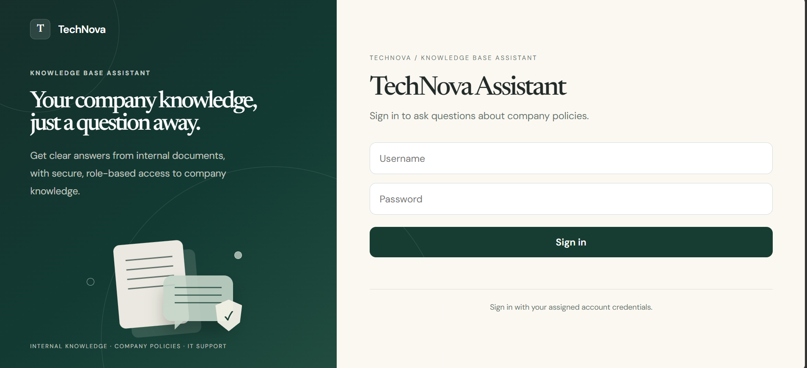
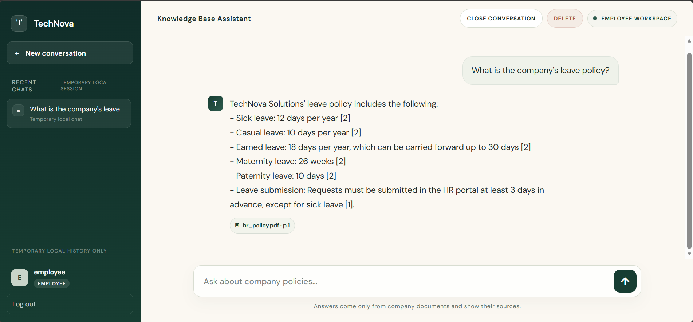
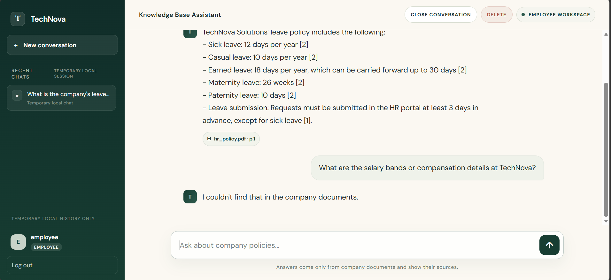
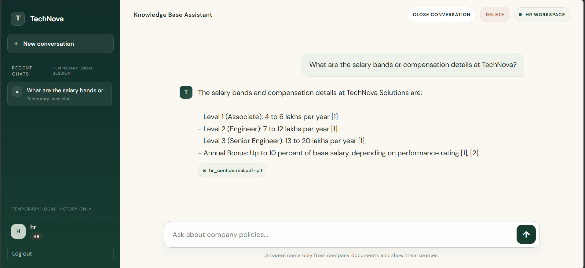

# TechNova Enterprise Knowledge Base Chatbot

A FastAPI retrieval-augmented chatbot that answers questions from TechNova's company PDFs. It uses ChromaDB for vector search, the `all-MiniLM-L6-v2` ONNX model for CPU embeddings, and Gemini for grounded answer generation. Employee and HR access rules are enforced in backend retrieval.

## Live demo

https://enterprise-kb-chatbot.onrender.com

This runs on Render's Free plan, which sleeps when idle. The first load can take a minute or more, so please wait for the login page.

### Demo access (public credentials, fictional data)

| Role     | Username | Password                              |
|----------|----------|---------------------------------------|
| Employee | employee | Emp@TechNova#2026!xR9  |
| HR       | hr       | HR@TechNova#2026!pK8         |

These credentials are public and only open fictional documents. Please do not enter real information.

Things to try:

- As either role: "What is the company's leave policy?"
- As HR, then as employee: "What are the salary bands or compensation details at TechNova?" HR gets an answer from the confidential document. Employee gets "I couldn't find that in the company documents."
- Ask something the documents do not cover, such as a pet policy, to see the fallback response.

## Screenshots

In my own testing after the app had been idle, the login page appeared in about 25 seconds and the first question took about a minute while the model loaded. Later questions took a few seconds.

### Login


### Employee: answer with source citation


### Employee cannot access confidential HR data


### HR can access the confidential salary document


## Features and architecture

- `ingest.py` extracts PDF text and splits it into chunks with source, page, and access metadata.
- `build_index.py` embeds chunks with the same ONNX pipeline used for queries and writes them to the `technova_kb` ChromaDB collection.
- `retrieve.py` applies the employee or HR access filter in the ChromaDB query. Employees can retrieve `all` documents; HR can retrieve `all` and `hr_only` documents.
- `chat.py` sends only retrieved context to Gemini, requests numbered citations, and returns `I couldn't find that in the company documents.` when retrieval finds no relevant context.
- `api.py` serves the frontend and API from the same origin, authenticates users with bearer tokens, and bounds response cache, sessions, and concurrent AI requests.
- `index.html` provides the login and chat interface. The browser stores its bearer token and chat history in page memory. Refreshing or closing the page clears browser-side state but does not revoke the server-side session. The session remains until logout, FIFO eviction (maximum 1,000 sessions), or server restart.

The tracked sample documents in `data/` are fictional: HR policy, IT support, onboarding, and a confidential HR salary document. Do not add real confidential material to a public repository or image without an appropriate access and data-handling review.

## Technology

Python, FastAPI, Uvicorn, ChromaDB, ONNX Runtime, Transformers/Hugging Face Hub, LangChain Google GenAI, PyPDF, and plain HTML/CSS/JavaScript. Production requirements are in `requirements.txt`; `requirements-dev.txt` adds pytest, PyTorch, and Sentence Transformers for development parity checks. Production retrieval and indexing use ONNX and do not require PyTorch.

## Requirements and local setup

- Python 3.13 (the Docker image uses `python:3.13-slim`).
- A Gemini API key for generated answers. Login and `/health` do not call Gemini.
- Internet access on first model use to download the Hugging Face tokenizer and ONNX model.

Clone the repository:

```bash
git clone https://github.com/mahekshaik147/enterprise-kb-chatbot.git
cd enterprise-kb-chatbot
```

Create and activate a virtual environment, then install production dependencies:

```powershell
python -m venv .venv
.venv\Scripts\Activate.ps1
python -m pip install -r requirements.txt
```

For parity tests that compare against Sentence Transformers, install development dependencies instead:

```powershell
python -m pip install -r requirements-dev.txt
```

Create a local `.env` (it is ignored by Git) or set these environment variables in your shell. Use distinct usernames and strong, unique passwords. Never commit real values.

```text
TECHNOVA_EMPLOYEE_USERNAME
TECHNOVA_EMPLOYEE_PASSWORD
TECHNOVA_HR_USERNAME
TECHNOVA_HR_PASSWORD
GOOGLE_API_KEY
```

A template with blank placeholders is provided in `.env.example`.

Start the API from the repository root:

```powershell
uvicorn api:app --host 127.0.0.1 --port 8000
```

Open `http://127.0.0.1:8000`; interactive API docs are at `http://127.0.0.1:8000/docs`. The UI uses relative same-origin `/login` and `/ask` URLs, so no localhost backend URL is embedded in the production frontend.

The existing local ChromaDB index is ignored by Git and is expected at `chroma_db/`. Do not run `python build_index.py` against an index you need to preserve: the script replaces the named collection. Build an index only when intentionally preparing a new one from the PDFs in `data/`.

## Authentication and API

Configure all four `TECHNOVA_*` credentials. If a value is blank or missing, or the two usernames match, login is unavailable. `POST /login` accepts `{"username":"your_username","password":"your_password"}` and returns a bearer token and role. `POST /ask` requires `Authorization: Bearer <token>` and accepts `{"question":"Your question here"}`. Questions are limited to 4,000 characters. `POST /logout` requires the bearer token and revokes that session. `GET /health` is an unauthenticated process health check; `GET /` serves the frontend.

The current server stores sessions in memory and has no persistent user store. A process restart clears sessions. The configured employee and HR credentials are shared role credentials, not individual employee identities.

The backend filters document access before sending context to Gemini. Employee questions cannot retrieve `hr_only` chunks; HR questions can retrieve both access levels. Keep this backend filter in place; hiding content in the UI is not an authorization boundary.

## Gemini behavior

The configured model is `gemini-3.6-flash`. `GOOGLE_API_KEY` is read through the Google GenAI integration. Empty retrieval results use the fixed fallback without an AI request. The API maps quota/rate-limit errors to HTTP 429 and temporary service availability errors to HTTP 503, with generic messages returned for other AI failures. The Gemini client uses a 30-second timeout and at most one retry (`max_retries=1`), so a slow or overloaded model returns a "busy" message within about a minute instead of hanging. If the model is repeatedly busy, check the Google AI Studio quota or try again later. No key or quota status is included in application logs or this repository.

The answer prompt asks Gemini to use only supplied context and cite numbered sources. Citation source records are derived from the returned reference numbers and retrieved chunks; this does not prove every generated claim is supported. Review answers and citations before using the sample with consequential or confidential company data.

## Tests and checks

```powershell
python -m pytest -q test_security.py
python -m pytest -q test_onnx_index.py
python -m pytest -q test_onnx_parity.py
python -m pip check
python -c "import api"
```

The parity test requires the development dependencies and may download model files. Tests use the local ChromaDB index and should not rebuild it. The manual Gemini smoke test in `test_setup.py` makes an external request that uses Gemini quota; run it only when you intend to use quota.

## Render deployment

The repository's `Dockerfile` is the deployment configuration. In Render, create a **Web Service** from this repository, choose the Docker runtime and Free instance where available, and use the repository root as the Docker build context. The image starts Uvicorn on `0.0.0.0` and reads Render's `PORT` (defaulting to `10000`); set the health check path to `/health` if configuring one. The frontend and API share the service origin, so configure no frontend API URL and no cross-origin CORS allowlist.

Render describes Free web services as suited to previews and hobby projects and cautions against using them for production. Treat this configuration as a demo/preview deployment; the project still needs production identity, session, and reliability design before handling real company data.

Set these names in the Render service environment; do not put values in the Dockerfile or repository:

- `TECHNOVA_EMPLOYEE_USERNAME`
- `TECHNOVA_EMPLOYEE_PASSWORD`
- `TECHNOVA_HR_USERNAME`
- `TECHNOVA_HR_PASSWORD`
- `GOOGLE_API_KEY`

The Docker build copies `data/*.pdf` and builds a fresh collection inside the image; it does not copy the ignored local `chroma_db/`. The ONNX model is downloaded and cached during the image build, so it does not need to be fetched when the first question arrives. Updating source PDFs requires building a new image. Render Free filesystems are ephemeral, so runtime changes to the index or other local files are not durable across replacement or redeploy. This app does not require a persistent disk for its image-bundled sample index; do not rely on runtime ingestion or index changes persisting. Free services sleep when idle and cold start, so the first request after a period of inactivity can take a minute or more. The health check intentionally does not initialize the model.

The app is deployed on Render's Free plan at https://enterprise-kb-chatbot.onrender.com, and both roles were tested on the live deployment. Gemini free-tier quota and availability can still cause temporary "busy" responses.

## Known limitations

- The sample knowledge base is small and fictional; retrieval evaluation is not a guarantee of answer accuracy.
- Gemini free-tier quota and service availability can block answer generation.
- Sessions and response cache are in memory and are lost on restart; credentials are shared by role.
- The app has no persistent index updates on Render Free and no user-management interface.
- Answers may show raw Markdown markers (such as `**`) because the chat interface displays model text as plain text.
- Generated claims and citation correctness need human review for production use.

All company names and sample users/documents are fictional and created for demonstration purposes.